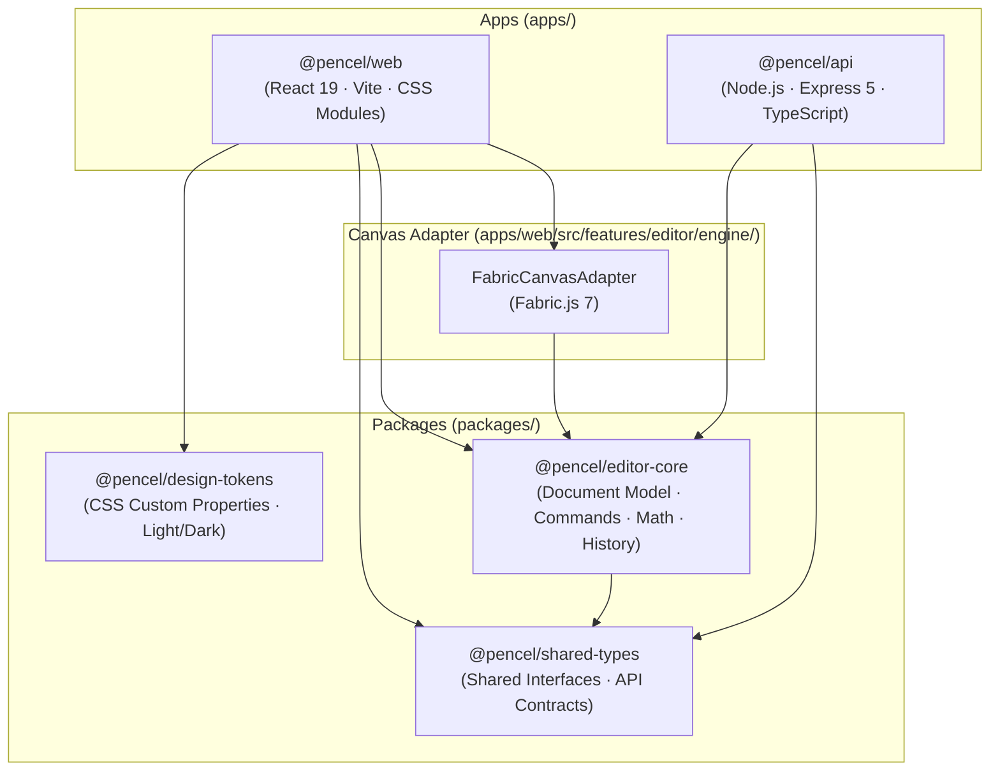

<div align="center">

# Pencel

**High-Performance Open-Source Web Graphic Studio**  
_Desktop-grade creative ergonomics inspired by macOS Human Interface Guidelines, powered by React 19 and autonomous generative AI._

[](LICENSE)
[](https://react.dev)
[](https://www.typescriptlang.org)
[](https://nodejs.org)
[](https://vitejs.dev)
[](#testing--quality-gates)
[](CONTRIBUTING.md)

[**Test Now**](https://pencelstudio.vercel.app/) · [**Explore Architecture**](#architecture--package-boundaries) · [**Quick Start**](#quick-start) · [**Documentation**](docs/) · [**Report Issue**](../../issues)

</div>

---

## ⚡ Overview

**Pencel** is a modern, privacy-first, desktop-class web graphics editor designed for content creators, marketers, developers, and designers. It blends the rapid, template-driven workflow of modern web suites (Canva) with the ergonomic precision, layer depth, and vector control of pro desktop creative software (Photoshop, Illustrator), all wrapped in an **Apple Human Interface Guidelines (HIG)** aesthetic.

Built from first principles on a zero-dependency domain model, Pencel features non-destructive raster photo filters, vector Bézier curve tools, precision rulers with dynamic magnetic snapping, and autonomous **Bring Your Own Key (BYOK)** generative AI layout synthesis supporting **Google Gemini, Anthropic Claude, OpenAI, and DeepSeek**.

```text
┌────────────────────────────────────────────────────────────────────────┐
│  Top Control Bar: Preset Switcher · Zoom · Artboard Reel · Export      │
├──────────────┬──────────────────────────────────────────┬──────────────┤
│ Tools & Nav  │  Infinite Canvas Stage                   │  Inspector   │
│              │                                          │              │
│ • Templates  │  ┌────────────────────────────────────┐  │ • Fill/Stroke│
│ • Vector     │  │  1080 × 1080 px Artboard           │  │ • Typography │
│ • Text       │  │                                    │  │ • Camera Raw │
│ • Media      │  │   [ Editable Typography ]          │  │ • Blend Mode │
│ • Camera Raw │  │   [ Vector Shapes & Paths ]        │  │ • Alignment  │
│ • BYOK AI    │  │   [ Smart Magnetic Guides ]        │  │ • Opacity    │
│ • Settings   │  └────────────────────────────────────┘  │              │
│              │   Floating Studio HUD · Quick Gestures   │              │
└──────────────┴──────────────────────────────────────────┴──────────────┘
```

---

## 💡 Why Pencel?

| Dimension           | Typical Web Editors (Canva / SaaS)                         | Pencel Studio                                                                       |
| :------------------ | :--------------------------------------------------------- | :---------------------------------------------------------------------------------- |
| **Data Privacy**    | Projects & assets stored on proprietary cloud servers      | **100% Local-First:** Your documents, images, and keys stay in your browser         |
| **AI Pricing**      | Expensive recurring subscription with restricted credits   | **Bring Your Own Key (BYOK):** Direct API access at wholesale token cost            |
| **Engine Coupling** | Canvas and React UI state tightly bound; fragile undo/redo | **Strict Five-Layer Architecture:** Pure domain core decoupled from canvas          |
| **UI Aesthetics**   | Heavy, cluttered, advertisement-filled chrome              | **Apple HIG Precision:** Restrained glass materials, tabular nums, neutral surfaces |
| **Vendor Lock-in**  | Proprietary exports; hard to migrate                       | **Open JSON Envelopes:** Standard JSON schemas, SVG vectors, and raw PNG/JPG        |
| **License**         | Closed source, paid paywalls                               | **100% Free & Open Source (MIT)**                                                   |

---

## ✨ Key Features

### 🎨 Precision Canvas Stage & Isolated Graphics Engine

- **Decoupled Architecture:** Built on top of an isolated `FabricCanvasAdapter` (Fabric.js 7) encapsulated behind a pure TypeScript domain model (`@pencel/editor-core`).
- **Infinite Viewport:** Fluid panning, trackpad pinch-to-zoom (10% to 500%), optical center alignment, and responsive retina device pixel scaling.
- **Multi-Artboard Reel:** Staggered visual artboard management with one-click cloning, renaming, deletion, and cross-page navigation.

### 📐 Photoshop-Grade Rulers & Magnetic Smart Snapping

- **Dynamic Pixel Rulers:** Adaptive step subdivisions with responsive tick marks synchronized with canvas zoom and panning.
- **Interactive Guides:** Drag guides directly from horizontal and vertical rulers onto the artboard with sub-pixel precision.
- **Bounding-Box Smart Guides:** Automatic magnetic snapping with visual alignment indicators and distance badges.

### 🤖 Autonomous Multi-Provider Generative AI (BYOK)

- **Prompt to Design:** Transform natural language descriptions into fully layered, editable canvas compositions in seconds.
- **Zero Middleman Markup:** Bring your personal API key—keys are stored exclusively in your browser's `localStorage` and never transmitted to our servers.
- **Multi-Model Catalog:**
  - **Google Gemini:** `gemini-2.5-flash`, `gemini-2.5-pro`
  - **Anthropic Claude:** `claude-3-7-sonnet`, `claude-3-5-haiku`
  - **OpenAI:** `gpt-4o`, `gpt-4o-mini`
  - **DeepSeek:** `deepseek-chat`, `deepseek-reasoner`
- **Multi-Key Profile Manager:** Save, label, and toggle between production and development keys seamlessly.

### 📸 Camera Raw Non-Destructive Photo Adjustments

- **Photoshop-Style Grading:** Real-time adjustments for Brightness, Contrast, Saturation, Vibrance, Hue Rotation, Blur, Noise, and Pixelation.
- **Layer Blend Modes:** Normal, Multiply, Screen, Overlay, Darken, Lighten, Color Dodge, Color Burn, Hard Light, Soft Light, Difference, and Exclusion.
- **AI Background Removal:** Instant background separation directly in the browser via client-side HuggingFace WebAssembly models, with server-side CLI fallback.

### ✒️ Vector Creation & Typography

- **Bézier Pen & Freehand Tools:** Draw custom geometric paths with interactive brush hardness preview, variable stroke weight, and line caps.
- **Modern Typography:** Full control over font family, font weight, optical tracking (letter spacing), line height, text alignment, and stroke borders.
- **Rich Shape Primitives:** Squircles, continuous-curvature rounded rectangles, circles, stars, polygons, badges, and decorative ribbons.

### 🍎 Apple-Inspired Glass UI Design System

- **Clarity, Deference, and Depth:** Layered translucent glass panels (`backdrop-filter`) that focus user attention on the canvas stage.
- **Complete Theme Parity:** Handcrafted Light (`[data-theme="light"]`) and Dark (`[data-theme="dark"]`) palettes meeting WCAG AA contrast ratios.
- **Ergonomic Floating HUD:** Convertible floating studio toolbar (dockable to bottom horizontal or left vertical layout).
- **Tabular Numerics:** All coordinates, dimensions, angles, and percentages use `font-variant-numeric: tabular-nums` to eliminate layout jitter.

---

## 🏛 Architecture & Package Boundaries

Pencel is structured as a modular monorepo managed with **npm Workspaces**. We strictly enforce unidirectional dependencies with zero circular references:



### Monorepo Structure

```text
pencel/
├── apps/
│   ├── web/                      # React 19 SPA client application
│   │   ├── src/features/editor/  # Canvas adapter, tools, state & UI
│   │   ├── src/features/ai/      # Multi-provider BYOK AI engine
│   │   ├── src/features/image/   # Camera Raw filters & background removal
│   │   ├── src/components/ui/    # Accessible design system primitives
│   │   └── src/shared/i18n/      # English, Portuguese, Spanish localization
│   └── api/                      # Standalone Express 5 backend service
│       ├── src/modules/health/   # Health & readiness probes (/api/v1/health)
│       ├── src/modules/ai/       # AI generation proxy
│       ├── src/modules/media/    # Stock media proxy (Unsplash/Pexels/GIPHY)
│       └── src/middleware/       # Rate limiting & defensive security headers
├── packages/
│   ├── design-tokens/            # Semantic CSS variables & Light/Dark themes
│   ├── editor-core/              # Pure TypeScript document domain & math
│   └── shared-types/             # Cross-package TypeScript contracts
├── docs/                         # Engineering, design & architecture docs
└── .github/workflows/ci.yml      # CI/CD Quality Gate pipeline
```

---

## 🚀 Quick Start

### Prerequisites

- **Node.js:** `>= 22.19.0` or `>= 24.11.0` LTS
- **npm:** `>= 10.0.0`
- **Git:** `>= 2.40`

### 1. Clone & Install

```bash
git clone https://github.com/your-username/pencel.git
cd pencel

# Install all workspace dependencies
npm install
```

> **Windows PowerShell Users:** If PowerShell script execution policies restrict `.ps1` execution, use `npm.cmd` and `npx.cmd` without modifying global system policies:
>
> ```powershell
> npm.cmd install
> ```

### 2. Run Locally

```bash
# Start both Web Client and API concurrently
npm run dev

# Or run services individually:
npm run dev:web    # Frontend on http://localhost:5173
npm run dev:api    # API on http://localhost:4000
```

_Note: The frontend is fully independent and functions seamlessly even when the backend API is offline._

### 3. Run with Docker Compose

```bash
# Build and start containerized web client and API
docker compose up --build
```

Access the studio at `http://localhost:3000` (Nginx-proxied web interface) and `http://localhost:4000/api/v1/health`.

---

## 🧪 Testing & Quality Gates

Pencel enforces uncompromising code standards with zero tolerance for `any` types or skipped checks:

```bash
# Run monorepo-wide static TypeScript type verification
npm run typecheck

# Run ESLint 9 across all packages
npm run lint

# Check code formatting with Prettier
npm run format:check

# Run automated unit and integration tests (Vitest)
npm run test

# Compile all workspace packages for production
npm run build
```

---

## 🌍 Internationalization (i18n)

Pencel features native internationalization with zero runtime bundle bloat:

- 🇺🇸 **English** (Default)
- 🇧🇷 **Português (Brasil)**
- 🇪🇸 **Español**

Switch languages dynamically at runtime via **Studio Settings → Language**.

---

## 🗺 Roadmap

- [x] Monorepo architecture with npm Workspaces, React 19, and Vite 8
- [x] Apple-inspired Light and Dark Design System (`@pencel/design-tokens`)
- [x] Isolated Fabric.js canvas adapter with lifecycle management
- [x] Dimension presets (Instagram, Story, Full HD Banner, Flyer, Ad)
- [x] Multi-page / artboard workflow with real-time replication
- [x] Camera Raw photo adjustment filters & blend modes
- [x] Autonomous BYOK AI layout generation (Gemini, Claude, OpenAI, DeepSeek)
- [x] Dynamic pixel rulers, draggable guides, and magnetic smart snapping
- [x] Containerization via Docker & Docker Compose
- [ ] **Milestone 1:** Advanced Bézier curve editing and boolean vector operations (Union, Subtract, Intersect)
- [ ] **Milestone 2:** Rich text curve wrapping, font pairing suggestions, and variable typography axes
- [ ] **Milestone 3:** Optional PostgreSQL sync and WebRTC/CRDT multi-user real-time collaboration
- [ ] **Milestone 4:** High-DPI rasterization (1x, 2x, 3x) and CMYK print-ready vector PDF export

---

## 🤝 Contributing

We welcome community contributions, bug reports, and feature proposals! Please read our [**Contributing Guide (CONTRIBUTING.md)**](CONTRIBUTING.md) and [**Architectural Decisions (docs/architecture/decisions/)**](docs/architecture/decisions/) before opening pull requests.

1. Fork the Project
2. Create your Feature Branch (`git checkout -b feature/AmazingFeature`)
3. Commit your Changes (`git commit -m 'feat: add amazing feature'`)
4. Verify all Quality Gates (`npm run typecheck && npm run test`)
5. Push to the Branch (`git push origin feature/AmazingFeature`)
6. Open a Pull Request

---

## 📄 License & Intellectual Property

Distributed under the **MIT License**. See `LICENSE` for more information.

- **Open Source Guarantee:** Pencel does not incorporate proprietary Apple typography files (`SF Pro`, `SF Mono`, `New York`), Apple UI kits, or Apple SF Symbols binary vectors. All iconography is licensed under ISC via `lucide-react`.
- **Zero Commercial Asset Infringement:** All UI components, vector brand marks, and canvas adapters are original implementations designed for web distribution.

---

<div align="center">
  <sub>Crafted with ergonomic care, architectural discipline, and love for great software design.</sub>
</div>
