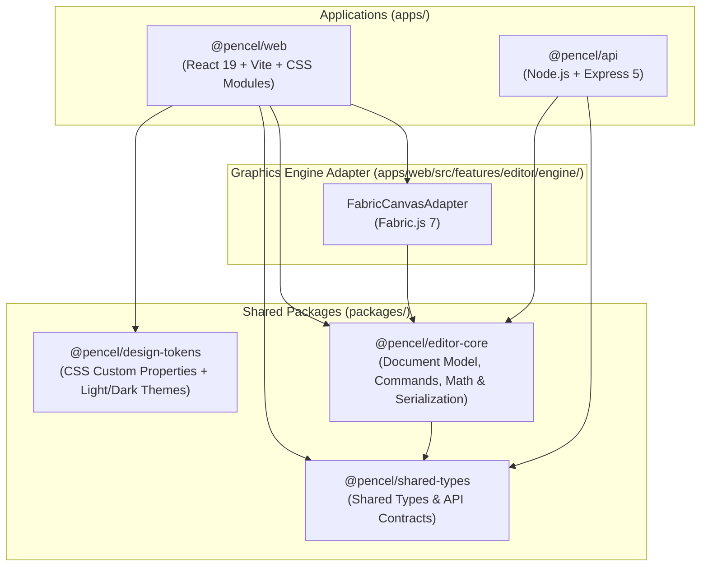

# Architecture Overview — Pencel

**Pencel** is structured as a modular monorepo powered by **npm Workspaces**, engineered to support the continuous evolution of a professional web graphics editor without premature coupling between UI presentation, canvas rendering, and backend services.

---

## 1. High-Level Architecture Diagram and Package Boundaries

---

## 2. Workspace Responsibilities and Boundaries

### 2.1 `@pencel/shared-types` (`packages/shared-types`)

- **Role:** Single source of truth for cross-cutting data contracts (IDs, dimension presets, API health payloads, project metadata, format definitions).
- **Constraints:** Zero dependencies on other workspace packages or external UI/DOM libraries.

### 2.2 `@pencel/editor-core` (`packages/editor-core`)

- **Role:** Pure domain logic and conceptual modeling for the graphics editor:
  - `document/`: Immutable creation and manipulation of documents (`DesignDocument`), artboard pages (`DesignPage`), and elements (`GraphicElement`: text, shapes, images, paths).
  - `commands/`: Deterministic command contracts and execution pipelines.
  - `history/`: State snapshot stack for bidirectional `undo/redo`.
  - `math/`: Pure coordinate space transformations, ruler calculations, snapping algorithms, and guides.
  - `serialization/`: Versioned JSON envelope serialization and schema validation.
- **Constraints:** Forbidden from importing `react`, `react-dom`, `fabric`, or browser-only DOM globals. Must compile and run unit tests in a pure Node environment.

### 2.3 `@pencel/design-tokens` (`packages/design-tokens`)

- **Role:** Centralized repository of all semantic CSS custom properties for colors, typography, spacing, layout metrics, border radii, shadows, and transitions, alongside complete Light and Dark theme palettes.
- **Constraints:** Contains only pure CSS style files and package metadata.

### 2.4 `@pencel/web` (`apps/web`)

- **Role:** High-performance SPA client application built with React 19, TypeScript, and Vite.
- **Internal Organization:**
  - `components/ui/`: Reusable design system primitives (`Button`, `Icon`, `Input`, `Tabs`, `Panel`, `Toolbar`, `Badge`, `Tooltip`, `Dialog`).
  - `components/layout/`: 4-zone structural shell inspired by desktop creative suites.
  - `features/editor/`: Session state, custom hooks, canvas stage, property inspectors, and the isolated `Fabric.js` engine adapter (`features/editor/engine/`) supporting high-fidelity multi-scale exports (1x, 2x Retina, 3x Print) and transparent PNG/SVG output.
  - `features/ai/`: Autonomous AI generation engine with BYOK multi-provider support.
  - `features/image/`: Camera Raw adjustments, background removal, in-browser WebAssembly image vectorization (VTracer), and media library.

### 2.5 `@pencel/api` (`apps/api`)

- **Role:** Node.js + Express 5 + TypeScript HTTP service providing environment validation, security headers, rate limiting, health probes (`/api/v1/health`), server-side AI proxying, and media proxies for external visual catalogs (Unsplash, Pexels, GIPHY).
- **Operational Independence:** Operates completely standalone without requiring an external database, while maintaining clear extension points for future cloud persistence.
