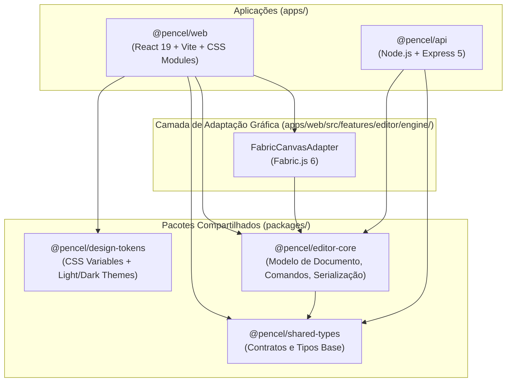

# Visão Geral da Arquitetura — Pencel

O **Pencel** é estruturado como um monorepositório modular baseado em **npm Workspaces**, projetado para suportar a evolução contínua de um editor gráfico web profissional sem acoplamento prematuro entre interface, motor de renderização e serviços de backend.

---

## 1. Diagrama de Arquitetura e Fronteiras de Pacotes

---

## 2. Responsabilidades de Cada Workspace

### 2.1 `@pencel/shared-types` (`packages/shared-types`)

- **Papel:** Fonte única da verdade para contratos de dados transversais (identificadores, presets de dimensões, payloads de saúde da API, metadados de projeto).
- **Restrições:** Zero dependências de outros pacotes do workspace ou de bibliotecas de UI/DOM.

### 2.2 `@pencel/editor-core` (`packages/editor-core`)

- **Papel:** Modelagem conceitual pura do domínio do editor gráfico:
  - `document/`: Criação e manipulação imutável de documentos (`DesignDocument`), páginas (`DesignPage`) e elementos (`GraphicElement`: texto, forma, imagem).
  - `commands/`: Contratos de comando para operações determinísticas.
  - `history/`: Estrutura base de pilha de estados (preparada para futuro `undo/redo`).
  - `serialization/`: Esquema de serialização/desserialização JSON versionado com validação segura.
- **Restrições:** Proibido importar `react`, `react-dom`, `fabric` ou APIs exclusivas do navegador. Deve compilar e rodar testes unitários em ambiente Node puro.

### 2.3 `@pencel/design-tokens` (`packages/design-tokens`)

- **Papel:** Centralizar todas as variáveis CSS semânticas de cores, tipografia, espaçamento, dimensões de layout, bordas, sombras e transições, além dos temas claro e escuro.
- **Restrições:** Contém apenas folhas de estilo CSS puras e metadados de pacote.

### 2.4 `@pencel/web` (`apps/web`)

- **Papel:** Aplicação cliente SPA em React + TypeScript + Vite.
- **Organização interna:**
  - `components/ui/`: Componentes base do design system (`Button`, `Icon`, `Input`, `Tabs`, `Panel`, `Toolbar`, `Badge`, `Tooltip`, `Dialog`).
  - `components/layout/`: Shell estrutural de 4 zonas inspirado em aplicativos criativos de desktop da Apple.
  - `features/editor/`: Estado da sessão de edição, hooks, componentes de palco/inspetor e o adaptador isolado para `Fabric.js` (`features/editor/engine/`).
  - `features/projects/`, `features/assets/`, `features/export/`: Módulos estruturados para expansão progressiva.

### 2.5 `@pencel/api` (`apps/api`)

- **Papel:** Servidor HTTP em Node.js + Express + TypeScript, com validação de configuração de ambiente, tratamento centralizado de erros e módulo de verificação de saúde (`/api/v1/health`).
- **Independência operacional:** Executa de forma totalmente autônoma sem exigir banco de dados ativo ou credenciais externas nesta fundação, mantendo pontos claros de extensão para persistência futura em PostgreSQL.
